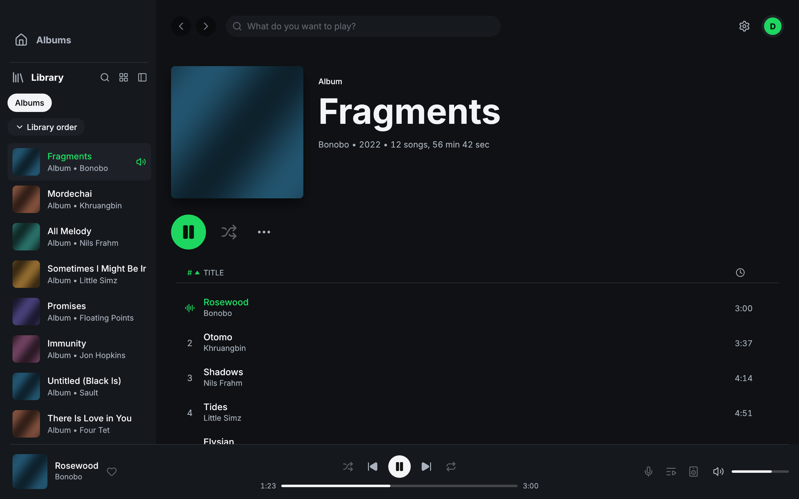

Navifast's first release candidate brings your Navidrome albums into a native desktop player, with original-audio streaming, an equalizer, and a spectrum display. This is an early preview for testing, maintained independently from Spotifast.

**Downloads:** choose the Mac DMG, Windows installer or ZIP, or Linux archive attached to this prerelease. The Mac DMG supports Apple Silicon and Intel. Windows and Linux archives are available for x64 and ARM64. Flatpak is included when its optional build succeeds.

**Installing on macOS:** this preview is not Developer ID-signed or notarized. Open the DMG, drag Navifast to Applications, then try opening it. If macOS blocks it because the developer cannot be verified, use **System Settings → Privacy & Security → Open Anyway** for Navifast, then confirm **Open**. Only do this for a download you trust from this repository. See [Apple's instructions](https://support.apple.com/en-us/102445).

*Navidrome album view with demonstration content.*

## New

- **Play your own Navidrome library.** Sign in, browse albums and artwork, and play original files with pause, seeking, previous, next, and automatic album progression. By @nizarcan.
- **Shape the sound and appearance.** Use the ten-band equalizer, spectrum display, light and dark themes, and interface preferences. By @nizarcan, building on Spotifast's native UI and DSP.
- **A distinct Navifast identity.** An original vinyl icon, separate app and configuration paths, and release signatures owned by this project. By @nizarcan.

## Fixed

- **Brief network delays are buffered.** Streaming reads up to 4 MiB ahead and prepares 200 ms of audio before starting or recovering, reducing interruptions with high-quality originals. By @nizarcan.
- **Mac disk images reserve enough working space.** Packaging specifies the image size instead of relying on an estimate that can fail. Adapted from @crmne's Spotifast fix, commit `3563c57`.

## Known limitations

- Mac downloads are ad-hoc signed only, and Windows downloads have no Authenticode signature. Your operating system may show an unidentified-publisher warning. The project's signed checksum manifest verifies the downloads separately.
- Search, favorites, playlists, queue editing, shuffle/repeat, lyrics, scrobbling, transcoding choices, Winamp/MilkDrop controls, and tray behavior are still being migrated.
- Passwords stay in memory. Sign in again after restarting. Automatic updates are not enabled.
- Audio is converted to stereo 44.1 kHz. Gapless playback, multichannel conversion, and bit-perfect output are not claimed. Original streaming needs HTTP byte-range support; there is no offline cache.
- Long network stalls or insufficient bandwidth can still interrupt playback. Broader codec, server, and desktop testing is welcome.

## Thanks

Carmine Paolino (@crmne) and the Spotifast contributors for the original native client, UI, audio processing, and platform work. Navifast retains the original MIT license notices and README attribution.

**Full changelog**: https://github.com/nizarcan/navifast/compare/579edbe2abde6652a9b5f5b2b8f108ade59eacb6...v0.1.0-rc.1
