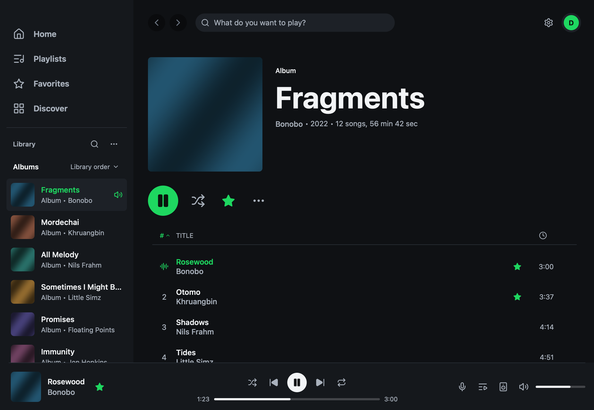

Navifast 0.2.1-rc.1 expands the first preview into a fuller native Navidrome player, with library search, playlists, lyrics, an editable queue and selected music available offline. This release candidate brings the desktop onto Rune and is ready for broader testing across macOS, Windows and Linux.

**Downloads:** choose the Mac DMG, Windows installer or ZIP, or Linux archive attached to this prerelease. The Mac DMG supports Apple Silicon and Intel. Windows and Linux archives are available for x64 and ARM64. Flatpak is included when its optional build succeeds.

**Installing on macOS:** this preview uses a self-signed certificate. It is not Developer ID-signed or notarized. Open the DMG, drag Navifast to Applications, then try opening it. If macOS blocks it because the developer cannot be verified, use **System Settings → Privacy & Security → Open Anyway** for Navifast, then confirm **Open**. Only do this for a download you trust from this repository. See [Apple's instructions](https://support.apple.com/en-us/102445).

*Native album view with demonstration content.*

## New

- **Explore your whole library.** Search songs, albums, artists and playlists; browse Songs and Genres; open artist discographies and guest appearances; and return to recent listening from Home. Discover also offers album year ranges, server listening history and random selections.
- **Make playlists and keep favorites close.** Create and edit writable playlists, add selected tracks to several destinations, star songs, albums and artists, and rate songs and albums on your Navidrome account.
- **Control what plays next.** Add songs and albums to the queue, move or remove upcoming entries, shuffle and repeat, and optionally continue with library Autoplay. Exclude songs, albums or artists from suggestions. Your queue and position restore paused after restart.
- **Follow and save lyrics.** Read server lyrics with timed highlighting and click-to-seek, optionally fill missing lyrics from LRCLIB, and save or copy selected lines as a local image. Word highlighting follows timestamps supplied by the source.
- **Keep selected music available offline.** Download songs, albums and playlists in Original quality, manage progress and retries, and play completed downloads after restart without a network connection. An optional, separately bounded audio cache reuses recently streamed bytes.
- **Keep account changes through an interruption.** Favorites, ratings and qualifying listens survive offline sessions and sync after reconnecting. Settings shows pending changes and retry controls, with uncertain listening submissions kept for review instead of silently sent twice.
- **Choose streaming quality and inspect the audio.** Use Original or MP3 at up to 64, 128, 192 or 320 kbps when the server supports it. Track details separates library metadata, decoded audio and configured output. Prepared tracks share a continuous playback path for supported gapless sources.
- **See listening history and complete artwork.** Report now playing and completed listens to Navidrome, inspect account-wide listening stats on demand, and open or save full album artwork.

## Fixed

- **Successful sign-ins are remembered securely.** The system credential store restores the login on startup while the main window shows its loading state. Passwords are not written to ordinary settings files.
- **Artwork stays visible while you browse.** View-sized covers, resident images for visible rows, and bounded caches reduce disappearing artwork. Home restores recent covers after sign-in and resolves missing artist photos.
- **Your latest action stays on screen.** Playlist edits, favorites, ratings and queue changes appear immediately while background work catches up. Stale server replies do not undo pending changes.
- **Native desktop interactions are restored.** Album and playlist row controls, search navigation, window placement, player controls and settings run through the Rune desktop. The Library shelf can show albums, playlists or both.
- **Mac previews use a consistent signing identity.** Local and remote builds can use the same certificate. Self-signed updates can still request Keychain authorization; this is not a promise of prompt-free reinstalls.

## Known limitations

- Mac downloads are self-signed and unnotarized. Windows downloads have no Authenticode signature. The project's signed checksum manifest verifies the release downloads separately.
- Audio processing uses stereo 44.1 kHz. Gapless software output is tested with 44.1 kHz WAV, FLAC and LAME-tagged MP3 fixtures; other combinations and physical device output need broader testing. Opus, bit-perfect output and multichannel output are not advertised.
- Original streaming requires HTTP byte-range support. Converted-audio seeking depends on server capabilities. Downloads contain selected music, not a complete offline library, and do not include artwork or lyrics. Tray behavior remains unavailable.

## Thanks

Features and fixes in this candidate were implemented by @nizarcan. Thanks to Carmine Paolino (@crmne) and the Spotifast contributors for the original native client, audio processing and platform work, and to the Rune contributors for the native desktop toolkit. Navifast retains the original MIT license notices and README attribution.

**Full changelog**: [v0.1.0-rc.1...v0.2.1-rc.1](https://github.com/nizarcan/navifast/compare/v0.1.0-rc.1...v0.2.1-rc.1)
