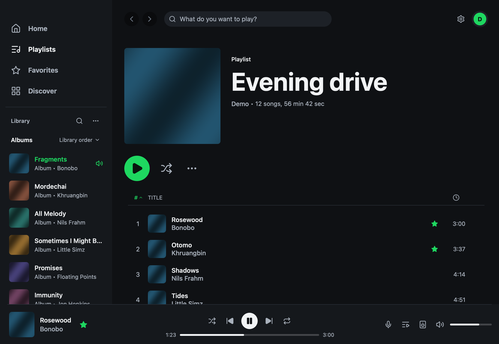

Navifast 0.2.2 is the first stable release. Track lists can show each song's cover, song and album menus lead straight to the album or artist, and right-clicking while a menu is open no longer gets stuck. The desktop now builds on the latest Rune toolkit.

**Downloads:** choose the Mac DMG, Windows installer or ZIP, or Linux archive attached to this release. The Mac DMG supports Apple Silicon and Intel. Windows and Linux archives are available for x64 and ARM64. Flatpak is included when its optional build succeeds.

**Installing on macOS:** this release uses a self-signed certificate. It is not Developer ID-signed or notarized. Open the DMG, drag Navifast to Applications, then try opening it. If macOS blocks it because the developer cannot be verified, use **System Settings → Privacy & Security → Open Anyway** for Navifast, then confirm **Open**. Only do this for a download you trust from this repository. See [Apple's instructions](https://support.apple.com/en-us/102445).

*A playlist in the Artwork track list style, with demonstration content.*

## New

- **Choose how track lists look.** **Settings → Appearance → Track list** offers Compact, Comfortable and Artwork. Artwork shows each song's cover beside its title in playlists, Favorites, Songs, Genres and downloads. Album pages keep Comfortable rows, since every cover would be the same. If you used the compact track list before, it stays compact.
- **Go to album and Go to artist.** Song menus in track lists, the queue and the player bar open the song's album or its primary artist. Album menus open the album's artist. An item is hidden when you are already on that page.

## Fixed

- **Right-clicking while a menu is open works again.** Before, further right-clicks were ignored until you left-clicked. Now a right-click outside an open menu closes it. On macOS and Linux, right-click again to open the next menu; on Windows, the menu under the pointer opens at once.
- **Updated native toolkit.** Navifast now builds on the latest Rune, with its patched window, graphics and accessibility components.

## Known limitations

- Mac downloads are self-signed and unnotarized. Windows downloads have no Authenticode signature. The project's signed checksum manifest verifies the release downloads separately.
- Audio processing uses stereo 44.1 kHz. Opus, bit-perfect output and multichannel output are not advertised.
- Original streaming requires HTTP byte-range support. Downloads contain selected music, not a complete offline library, and do not include artwork or lyrics. Tray behavior remains unavailable.

## Thanks

Features and fixes in this release were implemented by @nizarcan.

**Full changelog**: [v0.2.1-rc.1...v0.2.2](https://github.com/nizarcan/navifast/compare/v0.2.1-rc.1...v0.2.2)
